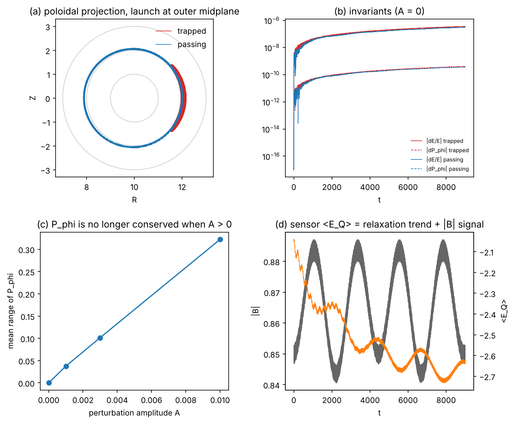

Fixed calibration issue causing incorrect accuracy. Delete complexity_power_grid_scan.csv and build a fresh one. 


# Quantum Gravity Lab (QGL)

**Quantum Gravity Lab (QGL)** is a small, semi-classical **quantum gravity lab in code**.

It couples:

- a test particle orbiting a compact mass (GR-like orbit),
- a co-moving quantum sensor (Jaynes–Cummings qubit–cavity),
- a phenomenological **complexity scalar** that modulates both gravity and quantum dynamics,

into a single, inspectable simulation pipeline.

The goal is **not** “here is a new theory of quantum gravity.”  
The goal is **“here is a clean, reproducible sandbox where geometry, quantum dynamics, and information-theoretic structure talk to each other.”**

---

## 1. Physics model in one page

### 1.1 Classical sector: orbit in a curved background

QGL tracks a test body of mass `m` moving in the field of a central mass `M`.  
Everything is integrated in coordinate time `t`.

The total acceleration is decomposed as

```text
a_total = a_Newt + a_GR + a_LT
````

where:

#### Newtonian gravity

```text
a_Newt = - G M * r_vec / r^3
```

with `r_vec` the position vector and `r = |r_vec|`.

#### GR-like precession term

We mimic the Schwarzschild 1PN precession by adding an explicit `1 / r^4` force:

```text
a_GR = - Lambda_Q(r) * gamma(v) * r_vec / r^4
```

* `gamma(v) = 1 / sqrt(1 - v^2 / c^2)` is the Lorentz factor.
* `Lambda_Q(r)` is a coupling coefficient,
* `v` is the speed of the test body.

The coupling is

```text
Lambda_Q(r) = alpha_GR * C_Q(r)
alpha_GR    = 3 * G * M * L^2 / c^2
```

where:

* `L` is the orbital angular momentum magnitude,
* `C_Q(r)` is the complexity scalar (see below).

`alpha_GR` is chosen so that, after calibration, the long-term perihelion precession matches the standard GR 1PN value

```text
Δω_GR = 6π G M / (c^2 a (1 - e^2))
```

for a bound orbit with semi-major axis `a` and eccentricity `e`.
This matching is enforced numerically by the **calibration loop** in `calibrate.py`.

#### Lense–Thirring frame dragging (optional)

To represent a spinning central body, QGL can add a simple gravitomagnetic correction:

```text
a_LT = (2 G M a_spin / (c^2 r^3)) * (v_vec × z_hat)
```

where `a_spin ~ J / (M c)` is a dimensionless spin parameter and `z_hat` is the spin axis.
In code this is implemented as an in-plane rotation of the velocity components.

---

### 1.2 Complexity scalar: where “quantum sensitivity” turns on

QGL uses a scalar **complexity field** `C_Q(r)` to control how strongly GR-like and quantum effects are switched on at a given radius:

```text
C_Q(r) = 1 / (1 + (r / r_trans)^p)
r_trans = k_rq * r_apo
r_apo   = a * (1 + e)
```

* `p` (“complexity power”) is a calibrated parameter.
* `r_trans` is tied to the apocenter `r_apo` of the orbit, so the transition scale follows the specific orbit.
* `k_rq` is a dimensionless factor that sets where the transition happens in units of `r_apo`.

Interpretation:

* `C_Q ~ 1` near the compact mass → GR-like corrections and quantum couplings are strong.
* `C_Q ~ 0` far away → dynamics revert to nearly Newtonian and quantum couplings are weak.

The complement

```text
C_N(r) = 1 - C_Q(r)
```

can be used wherever an explicitly “more Newtonian” weighting is convenient.

Operationally, `C_Q(r)` is the **main control knob** that:

* weights GR vs Newtonian forces,
* modulates the Jaynes–Cummings parameters,
* and enters our information-theoretic diagnostics (Bell parameter ansatz, etc).

---

### 1.3 Clocks, lapse, and redshift

The orbit is integrated in **coordinate time** `t` (time at infinity).
The co-moving quantum sensor evolves in **proper time** `τ`.

For a Schwarzschild-like background, the relation is

```text
dτ/dt = sqrt(1 - 2 G M / (c^2 r))
```

This lapse factor is used for:

* converting each coordinate-time step `Δt` into the proper-time step `Δτ` used in quantum evolution:

  ```text
  Δτ = (dτ/dt) * Δt
  ```

* computing simple gravitational redshifts between two radii `r_e` (emitter) and `r_o` (observer):

  ```text
  1 + z = ν_o / ν_e = (dτ/dt at r_e) / (dτ/dt at r_o)
  ```

---

### 1.4 Quantum sector: co-moving Jaynes–Cummings sensor

Along the orbit we propagate a Jaynes–Cummings (JC) system:

* a two-level atom (qubit),
* coupled to a single bosonic mode (cavity).

The Hamiltonian in the rotating-wave approximation is

```text
H_JC = ħ ω_c(r) a† a
     + (ħ ω_a(r) / 2) σ_z
     + ħ g(v) (a† σ_- + a σ_+)
```

The key idea is that **all three parameters** are tied to geometry:

```text
ω_c(r) = ω_c0 * [1 + s_ρ * (ρ(r) / ρ_ref)]
ω_a(r) = ω_a0 * [1 + s_φ * (Φ(r) / Φ_ref)]
g(v)   = g_0  * [1 + s_v * (|v|   / v_ref)]
```

where:

* `ρ(r) ∝ r^-2` is a simple local “density proxy”,
* `Φ(r) = - G M / r` is the gravitational potential,
* `s_ρ`, `s_φ`, `s_v` are user-tunable sensitivity coefficients.

**Time evolution**

At each step:

1. Convert `Δt` → `Δτ` using the lapse factor.

2. Compute the local `H_JC( r(t), v(t) )`.

3. Update the density matrix `ρ` by

   ```text
   ρ(t + Δt) = U ρ(t) U†
   U = exp(-i H_JC Δτ / ħ)
   ```

4. Optionally apply a simple Lindblad-style dissipation for cavity decay and qubit relaxation.

From `ρ` we compute:

* the reduced qubit state `ρ_q` (trace out the cavity),
* Bloch vector components `⟨σ_x⟩`, `⟨σ_y⟩`, `⟨σ_z⟩`,
* photon number `⟨n⟩`,
* coherence `|ρ_01|`,
* and entanglement entropy `S(ρ_q)`.

These are what drive the Bloch sphere and quantum diagnostics in the viewers.

---

### 1.5 Bell-style correlations (phenomenological)

To explore how curvature and motion might affect CHSH-type signals, QGL defines a **model ansatz** for an effective Bell parameter `β(r)`:

```text
β(r) = β_cl + C_Q_eff(r) * (β_qm - β_cl)
```

with:

* `β_cl = 2`   (classical CHSH bound),
* `β_qm = 2√2` (Tsirelson bound).

The effective coefficient combines:

```text
C_Q_eff(r) = C_Q(r)
             * sqrt(1 - 2 G M / (c^2 r))   # gravitational redshift
             * (2 - 1/γ)                   # kinematic factor
```

where `γ` is the Lorentz factor.

**Important:**
This `β(r)` is **explicitly a phenomenological model**, not a claim about the actual behavior of CHSH experiments in GR. The point is to have a tunable, physically-motivated diagnostic that responds to curvature, speed, and complexity in an interpretable way.

---

## 2. Repository layout

```text
QUANTUMGRAVITYLAB/
├── qgl_precession.py       # Event-based precession measurement + exact complexity_power solve
├── qgl_tokamak.py          # Tokamak mode: ion packet in a toroidal field, trapped/passing orbits, JC sensor
├── qgl_jc_lindblad.py      # Positivity-preserving decay for the JC sensor (core engine's is not)
├── figures/qgl_tokamak.png
├── qgl_ensemble.py         # Batch/ensemble orbit runner (CSV, parallel, seeded)
├── qgl_einsteinpy.py       # EinsteinPy cross-checks: exact Schwarzschild/Kerr precession vs QGL
├── qgl_kasner.py           # Kasner vacuum cosmology: symbolic check, geodesics, singularity morphology
├── qgl_curvature.py        # Complexity scalar + JC sensor driven by the Kretschmann scalar K
├── qgl_bkl.py              # BKL / Mixmaster: Kasner-epoch map, Bianchi IX solver, sensor with comoving or moving observer
├── tests/test_qgl.py       # pytest physics + regression suite
├── requirements.txt
├── calibrate.py            # Precession-based calibration of complexity_power p, k_rq, etc.
├── documentation.pdf       # Theory & implementation notes (LaTeX/PDF spec)
├── unified_sandbox_core.py # QGL core: config, EOM, complexity field, JC engine
├── unified_simulation.py   # “Offline” QGL run + standard orbit/JC viewer
├── unified_bell_state.py   # Bell State Edition: entanglement + CHSH visualization
├── unified_darkmatter.py   # Dark-matter / protomatter sandbox built on the same core
```

High-level roles:

* **`unified_sandbox_core.py`**
  Core `Config`, orbit integrator, GR/complexity force terms, JC operators, clock conversions, and shared utilities.

* **`unified_simulation.py`**
  A standard **QGL run**: configure an orbit, integrate once, evolve the JC sensor, and inspect everything via a Matplotlib dashboard.

* **`unified_bell_state.py`**
  “Bell State Edition” with:

  * an **Entanglement Console** to choose presets and parameters,
  * a **BellCorrelationViewer** showing `β(t)`, violation regions, entropy, concurrence, discord, orbit coloring, phase space, Bloch sphere, photons, and coherence.

* **`unified_darkmatter.py`**
  Experimental dark-sector / “protomatter” sandbox reusing the same complexity and coupling machinery.

* **`calibrate.py`**
  Scans over `(p, e)` grids, optimizes `complexity_power` to match GR precession, and writes `complexity_power_grid_scan.csv`.
  Main scripts use this table and only fall back to on-the-fly calibration for unseen orbits.

---

## 3. Installation

QGL uses a standard scientific Python stack.

```bash
git clone https://github.com/<your-handle>/QuantumGravityLab.git
cd QuantumGravityLab

python -m venv .venv
# Linux / macOS:
source .venv/bin/activate
# Windows:
# .venv\Scripts\activate

pip install numpy scipy matplotlib pandas
```

The reference implementation runs on CPU; array backends can be swapped to CuPy / JAX for GPU experiments.

---

## 4. Quickstart

### 4.1 Standard QGL orbit

```bash
python unified_simulation.py
```

What it does:

* loads or calibrates `complexity_power` for the chosen `(p, e)` orbit,
* integrates the trajectory (including GR-like corrections and optional frame dragging),
* evolves the JC sensor along the orbit in proper time,
* opens an interactive viewer with:

  * orbit geometry,
  * energies and angular momentum,
  * clock rates (GR vs quantum),
  * complexity,
  * Bloch sphere and quantum diagnostics.

### 4.2 Bell State Edition

```bash
python unified_bell_state.py
```

1. **Entanglement Console**

   * choose a preset like “MAX VIOLATION”, “DECOHERENCE”, or “SINGULARITY”,
   * or tune `p`, `e`, `n_orbits`, `n_output`, and JC sensitivity sliders `s_ρ`, `s_φ`, `s_v`.

2. Press **“ENTANGLE”**

   * QGL runs a single high-resolution simulation,
   * launches **BellCorrelationViewer** in a separate process.

3. In the viewer you can:

   * play/pause, scrub time, and change playback speed,
   * see where Bell violations cluster along the orbit,
   * correlate entropy, concurrence, and discord with geometry and complexity,
   * watch the qubit’s Bloch vector trace out trajectories on the sphere,
   * inspect photons, coherence, and complexity over time.

### 4.3 Complexity calibration

```bash
python calibrate.py
```

This script:

* scans a grid of `(p, e)` values,
* finds `complexity_power` for each orbit that matches GR 1PN precession,
* writes results to `complexity_power_grid_scan.csv`.

---

### 4.4 Ensembles and exact precession (new)

`calibrate.py` locates periapsis as local minima of `r(t)` on the output grid, so its
angular resolution is set by `n_output`.  At the default settings that resolution is about
the size of the precession itself (~1e-3 rad/orbit) and the measured shift can come out with
the wrong sign.  `qgl_precession.py` instead locates every periapsis with an ODE event
(`r . v = 0`), so the orbit-to-orbit scatter drops to ~1e-11 rad and is reported with every
measurement.

```bash
# a grid of orbits: measured / 1PN precession for each (p, e)
python qgl_ensemble.py --p 60 100 200 --e 0.1 0.3 0.6 --out grid.csv

# 40 seeded random orbits, solving complexity_power per orbit so the ratio is 1, with a plot
python qgl_ensemble.py --random 40 --seed 1 --solve --plot ensemble.png

# tests
pip install -r requirements.txt
python -m pytest -q
```

Without a calibration table the shipped defaults (`complexity_power = 0.7`,
`k_rq = 1.77771`) give 0.70--0.81 of the 1PN advance for the 9 orbits of the grid above;
`--solve` finds the `complexity_power` (about 2.1--2.4 there) that gives exactly 1.
Treat that as a statement about this one-parameter family, not as evidence for the model.

### 4.5 Tokamak mode (new, stylised)

`qgl_tokamak.py` is roadmap item 1: the test particle becomes a charged ion in an
axisymmetric tokamak field, and the JC sensor and a complexity profile are carried across.



*Physics (each point is tested in `tests/test_tokamak.py`).*  Large-aspect-ratio field
`B_phi = B0 R0/R` plus a poloidal field derived from a flux function
`psi = B0 rho^2 / (2 q0)`, so `div B = 0` exactly and `P_phi = m R v_phi + q psi` is an exact
invariant.  Full Lorentz-force orbits (units `B0 = 1`, `q/m = 1`).  For the unperturbed field:
energy is conserved to ~1e-6 (secular, integrator-limited) and `P_phi` to ~1e-9; the magnetic
moment only adiabatically.  Launched at the outer midplane, an ion is trapped when
`(v_par/v)^2 < 2 rho0/(R0 + rho0)`; orbits at 0.8x and 1.25x of that threshold behave
accordingly, passing ions advance poloidally at `v_par t / (2 pi q R0)` to within 15%, and a
deeply trapped ion's bounce period is within 20% of the small-epsilon formula (about 13% above
it in the test, as expected at `epsilon = 0.2`).

*Stylised (no claim of fusion relevance).*  The "complexity" profile
`C_T(rho) = 1/(1 + (rho/rho_t)^p)` has the same form as `C_Q(r)` and multiplies the amplitude of
an electrostatic wave `dphi = A C_T cos(m theta - n phi - w t)`.  With `A > 0`, `P_phi` is no
longer conserved and its spread grows with `A` (panel c); `confinement_scan` tabulates that and
the fraction of ions lost to the wall.  In the runs here no ion reached the wall within the
integration time, so the spread of `P_phi` is the usable measure, and no control claim is made.
The sensor's atomic frequency follows `|B|`, so its energy carries the bounce motion on top of its
own relaxation (panel d); that is by construction, not an independent measurement.

```bash
python qgl_tokamak.py             # short demonstration
python qgl_tokamak.py --figure    # regenerate figures/qgl_tokamak.png (about 45 s)
```

**Found while building this:** the core `JCQuantumEngine._apply_decays` damps populations but not
coherences, so the density matrix becomes non-positive (smallest eigenvalue about -0.012 after a
few time units) and `<sigma_z>` can fall below -1.  `qgl_jc_lindblad.LindbladJCEngine` replaces just
that step with the Kraus form of the same two decay channels; the tokamak sensor uses it.  The core
is unchanged, and `test_core_decay_breaks_positivity` documents the problem.  Swapping the engine
into the main pipeline would change its outputs slightly, so that is your call.

### 4.6 Anisotropic cosmology and EinsteinPy (new)

These modules are optional and need `pip install einsteinpy` for the symbolic and exact-GR parts.
The core (`unified_sandbox_core.py`) is not modified.

* **`qgl_einsteinpy.py`**: compares QGL's measured periapsis advance with the exact Schwarzschild value (elliptic-integral form) and with EinsteinPy's geodesics.
* **`qgl_kasner.py`**: Kasner exponents and the two vacuum conditions, symbolic Ricci / Riemann / Kretschmann via EinsteinPy, exact timelike geodesics, and `singularity_type(p)` (point / cigar / barrel / pancake).
  Vacuum Kasner is a cigar at the singularity unless it is flat, `(0, 0, 1)`.
* **`qgl_curvature.py`**: rewrites the complexity scalar and the sensor density proxy in terms of K. On Schwarzschild this reproduces the radius-based forms exactly; it also works where there is no radius (Kasner, Mixmaster).
* **`qgl_bkl.py`**: the Belinski–Khalatnikov–Lifshitz epoch map and a vacuum Bianchi IX (Mixmaster) integrator, with the sensor riding through the bounces on a comoving or a moving (geodesic) worldline.
  The coupling from curvature and speed to the sensor is a modelling choice, not derived physics.

```bash
python qgl_kasner.py        # symbolic Kasner table
python qgl_bkl.py           # sensor through Mixmaster bounces
pytest tests/ -q            # add --runslow for the slow EinsteinPy checks
```

## 5. Scientific status and roadmap

**What QGL *is***:

* A **computational lab** where:

  * GR-inspired corrections,
  * quantum sensors,
  * and information-theoretic diagnostics

  all act on the same orbit in a consistent codebase.

* A platform for experimenting with **geometry → quantum mapping**:
  how curvature and motion can be turned into tunable quantum parameters and observables.

**What QGL *is not***:

* A claim of a complete or correct quantum gravity theory.
* A production-grade astrodynamics package.

### Near-term directions

1. **Fusion-oriented extensions** (first step done: `qgl_tokamak.py`)

   * Replace Keplerian orbits with a simple tokamak-style geometry (closed magnetic field lines).
   * Interpret the “test particle” as a representative ion packet.
   * Use the JC sector as a stylized fusion sensor, and the complexity field as a proxy for local turbulence / instability.
   * Explore how modulation of geometric and complexity parameters might be used as a control-theoretic lever.

2. **Dark matter / protomatter sandbox**

   * Use `unified_darkmatter.py` to test alternative complexity / coupling rules and see how they modify effective mass distributions and orbital signatures.

3. **GPU and ensemble runs**

   * CPU ensembles of orbits now exist (`qgl_ensemble.py`).
   * Batch many orbits and JC sensors in parallel on GPU.
   * Turn QGL into a Monte-Carlo-style “quantum gravity lab” for exploring parameter spaces.

### Further reading (anisotropic cosmology and exact solutions)

* P.-P. Dechant, A. N. Lasenby, M. P. Hobson, *An anisotropic, non-singular early universe model leading to a realistic cosmology*, [arXiv:0809.4335](https://arxiv.org/html/0809.4335v2).
  A scalar field in a biaxial Bianchi IX geometry gives a “pancaking” Big Bang with finite curvature invariants.
  Also a compact statement of the point / pancake / cigar / barrel singularity types.

* S. Cotsakis, A. P. Yefremov, *100 years of mathematical cosmology: Models, theories, and problems*, [arXiv:2203.16443](https://arxiv.org/html/2203.16443v1).
  Survey covering the Kasner solution (Sec. 2.8), Bianchi models (Sec. 2.14) and BKL / Mixmaster (Secs. 3.4–3.5).

* Einstein Toolkit, [`EinsteinInitialData/Exact` thorn guide](https://einsteintoolkit.org/thornguide/EinsteinInitialData/Exact/documentation.html).
  Library of exact spacetimes (Kasner variants, Schwarzschild and Kerr in several coordinates, and others) as 3+1 initial data; useful as an independent cross-check for the exact solutions used here.

---

## 6. License and contact

This project is released under **CC0 1.0 Universal** (public domain dedication).
You are free to copy, modify, and use it for any purpose, including commercial and research work.

Questions, ideas, or collaboration proposals:

**Jon Poplett**
Creator, Quantum Gravity Lab (QGL)

