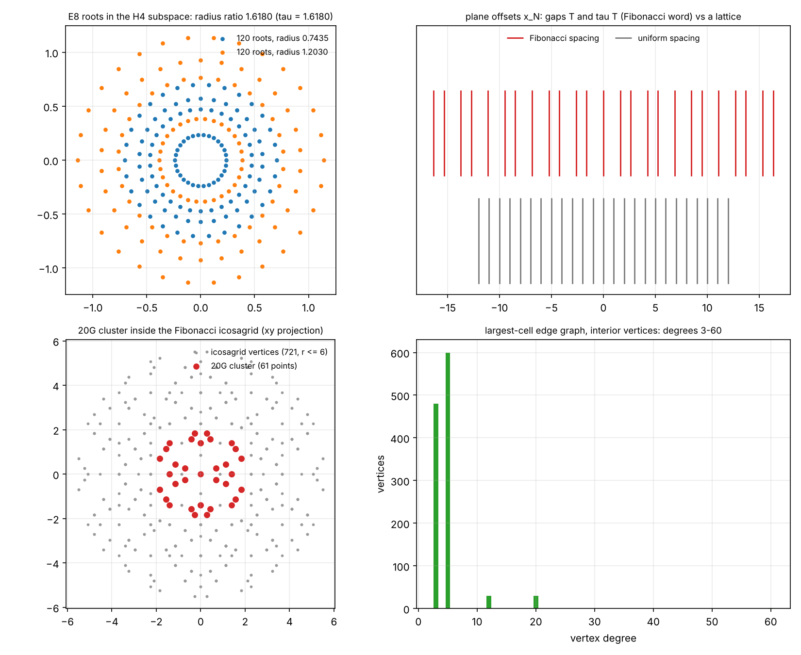
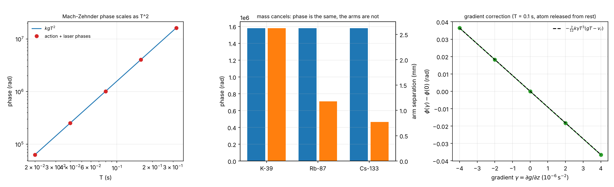

# Figures

Every figure is regenerated by its module (`make figures` runs them all; `make help` lists the single-figure targets). Three were added with the E8 / quasicrystal, quadratic-gravity and atom-interferometer work. Each is a check of a statement made in `QUANTGRAV.md`, not a result about a theory of quantum gravity.

## `qgl_qsn.png`: the E8 to quasicrystal chain

`python qgl_qsn.py --figure` (or `make figure-qsn`).

Four panels, one per link of the chain described in `QUANTGRAV.md`, section 1.

- **Top left.** The 240 E8 roots projected into the H4 subspace of a Coxeter element fall on two shells of 120, with radii in the golden ratio (1.2030 / 0.7435 = 1.6180). The picture is the usual one for the Elser-Sloane construction; it is the E8 half of `tests/test_e8.py`.
- **Top right.** The plane offsets `x_N` of one tetragrid chain, Fibonacci spacing against uniform spacing. Fibonacci gaps take two lengths, `T` and `tau T`, and the short gap is never repeated (`tests/test_qsn_extra.py`: the long-to-short ratio tends to tau). The uniform chain is the FCC case.
- **Bottom left.** The 61-point 20G cluster (five 4Gs related by 5-fold rotations) against the vertices of the Fibonacci icosagrid within radius 6, in an xy projection. All 61 points are icosagrid vertices at the scale where the first planes carry the cuboctahedron vertices.
- **Bottom right.** Vertex degrees of the edge graph of the largest tetrahedral cells, interior vertices only. The range is 3 to 60, the one reported in arXiv:1511.07786; degree 3 needs a large enough region.

Two findings from the tests are not visible in the picture. Every icosagrid vertex coordinate has the form `(sqrt(3)/2)(a + b tau)/2` with integers `a, b` (the `sqrt(3)/2` is a property of the icosahedral basis used here). And no two tetrahedral cells share a triangle, so the spin-network rule "nodes = tetrahedra, links = shared triangles" gives an empty graph; cells touch along edges and at vertices only.

Limits: only the central 20G cluster is tested against the Fibonacci icosagrid, not the whole Compound Quasicrystal. The E8 shells use the H4 projection, not the exact Elser-Sloane window. The Fibonacci offsets (`alpha = 0, beta = 1/2`) are my choice, made to get the symmetry about the origin.

## `qgl_quadgrav.png`: where a Weyl-squared term would matter

`python qgl_quadgrav.py --figure` (or `make figure-quadgrav`).

Quadratic gravity (R + R^2 + Weyl^2) is the subject of `QUANTGRAV.md` 2.4. This figure does not solve its field equations. It computes the Weyl scalar `C^2 = K - 2 Ric^2 + R^2/3` on geometries the repository already has, to show which of them a Weyl^2 term could act on.

- **Left.** `C^2 / K` along flat LCDM is zero to roundoff: flat FLRW is conformally flat for any `H(t)`, so there is no Weyl curvature for the term to act on and only R^2 can matter in the homogeneous background. Vacuum Kasner is the opposite limit: Ricci is zero, so `C^2 = K` and the ratio is exactly 1.
- **Middle.** The pancake (`a0 = 1, b0 = 3, f0 = 2, m = 0.5, Lambda = 0.1`) with its scalar field. `K`, `C^2` and `Ric^2` are all finite through `t = 0` and change sign or size smoothly (symlog axis). Weyl and Ricci curvature are both present, and the Weyl share of the geometry never reaches 1.
- **Right.** Vacuum Mixmaster. Ricci is zero so `C^2 = K`, which grows by tens of orders of magnitude toward the singularity. The red curve dips where `K` changes sign at a bounce; the dashed curve, `sqrt(K^2 + K*^2)` with `K*` the Pontryagin-type invariant, does not.

The Ricci formulas were checked against independent routes (`tests/test_quadgrav.py`): the pancake solution satisfies its own Einstein equations, `R_ii = kappa V + Lambda` and `R_00 = kappa (phi'^2 - V) - Lambda`; vacuum Kasner and Mixmaster have `Ric = 0`; and `C^2` equals the existing Kasner closed form and the existing Mixmaster Weyl invariants. There is no brute-force off-shell Riemann check of the Ricci part.

Limits: nothing here says whether the mode proposed in arXiv:2603.07150 is real, and the mapping from the phys.org article to that paper is inferred (see `QUANTGRAV.md`). That the Bach tensor vanishes on conformally flat metrics is a standard fact and is not tested here.

## `qgl_atom_phase.png`: the gravitational phase of a falling atom

`python qgl_atom_phase.py --figure` (or `make figure-atom`).

A three-pulse light-pulse interferometer (Kasevich-Chu): pulses at `0, T, 2T` split, redirect and recombine the atom, with effective wavevector `k` (Rb-87 at 780 nm). The phase is computed from the classical arm trajectories as the action difference plus the three laser phases plus a separation phase, not by inserting the formula.

- **Left.** Phase against `T`, log-log: the numerical points lie on `k g T^2` (slope 2). In uniform `g` the propagation (action) phase is zero to 1e-9 of the total and the arms recombine exactly.
- **Middle.** K-39, Rb-87 and Cs-133 at the same `k` and `T`. The phase (blue) is the same for all three; the arm separation `hbar k T / m` (orange) is not. This is the Colella-Overhauser-Werner form `m g delta T / hbar`, in which the mass cancels, and it is the equivalence-principle statement the interferometer tests. `tests/test_atom_phase.py` injects a violation `eta - 1 = 3e-7` into one species and recovers it from the differential phase to 1e-4.
- **Right.** A gravity gradient `g(z) = g0 + gamma z`, atom released from rest. The change in phase follows `-(7/12) k gamma T^3 (g T - v_r)` (`v_r = hbar k / m`, the recoil velocity) to better than 0.5%; the residual is a `v_r^2` term. The propagation and separation phases are each about 1e-2 rad at `gamma = 2e-6 s^-2` and cancel, which is a useful consistency check on the numerics.

Limits: this is the textbook geometry, not the Quantum Galileo experiment of `QUANTGRAV.md` 2.3, which I read only from press coverage (one arm held against gravity, the other launched; no numbers). There is no link from this phase to the Jaynes-Cummings sensor, because the repository has no such mapping and an overlay would be invented. A phase consistent with the equivalence principle does not show that gravity is quantum; see `QGL.md` section 1.6.
